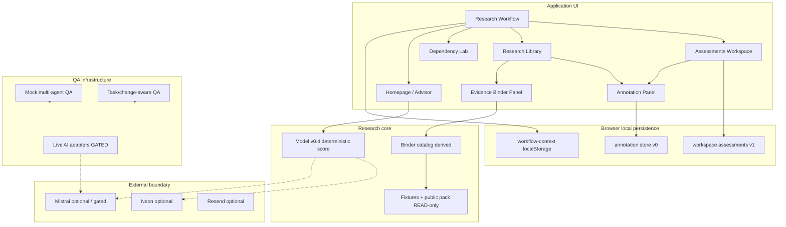

# P6-S12 — Technical Readiness Audit

**Audit date:** 2026-11-27  
**Decision input for:** READY / READY WITH LIMITATIONS / NOT READY

---

## 1. Automated verification (exact commands)

| Command | Kind | Result | Notes |
| --- | --- | --- | --- |
| `npm run test:fixtures` | Deterministic | **PASS** | 5 fixtures |
| `npm run test:evidence-pack` | Deterministic | **PASS** | Pack immutable; 83 · B |
| `npm run test:evidence-intake` | Deterministic | **PASS** | Synthetic intake |
| `npm run test:dependency-lab` | Deterministic | **PASS** | Non-scoring panel |
| `npm run test:evidence` | Deterministic | **PASS** | Provenance |
| `npm run test:evidence-binder` | Deterministic | **PASS** | 67 records |
| `npm run test:evidence-annotations` | Deterministic | **PASS** | Persist/intent |
| `npm run test:workflow-integrity` | Deterministic | **PASS** | 7/7 stages |
| `npm run test:boundaries` | Deterministic | **PASS** | LICENSE/pack/REVIEW/83·B |
| `npm run test:workflow` | Deterministic | **PASS** | Workflow integration |
| `npm run test:qa-agents` | Synthetic/mock | **PASS** | Not live AI review |
| `npm run test:task-qa` | Synthetic/mock | **PASS** | Change-aware mock |
| `npm run test:qa-execution` | Deterministic | **PASS** | Snapshot/exec gates |
| `npm run test:score` | Deterministic | **PASS** | Sanity cases |
| `npm run test:qa-live` | Infra + gated live | **BLOCKED** (live) / infra OK | `GRYPS_QA_LIVE` unset — **no model calls** |
| `npx tsc --noEmit` | Deterministic | **PASS** | Clean |
| `npm run build` | Deterministic | **PASS** | Routes include workflow/lab/workspace |
| `npm run test:research-qa` | Aggregate | **PASS** | Exit 0 |

Log artifacts (local): `_p6-s12-test-research-qa.log`, `_p6-s12-test-qa-live.log`, `_p6-s12-tsc.log`, `_p6-s12-build.log`

## 2. Browser smoke testing

| Item | Finding |
| --- | --- |
| Playwright in package.json / node_modules | **Absent** |
| Proportionate to introduce? | **No** for freeze audit — large new surface; journey already covered by `test:workflow-integrity` |
| Result | **NOT RUN** — documented limitation |

## 3. Privacy and security

| Area | Finding | Severity |
| --- | --- | --- |
| `.gitignore` for `.env` / `.env.*` / `.qa/` | Present | OK |
| Secrets in chat/reports | None copied | OK |
| Live AI during verification | Gated off; seed eval SKIPPED | OK |
| `loadEnvLocal` | Loads for CLI without logging values | OK |
| LocalStorage | Workflow, workspace assessments, annotations, theme, lang, anon runs — **browser-local only** | Limitation |
| Malformed persistence | Annotation store: array/unknown schema → empty; workspace: non-array → [] | OK |
| User-supplied URLs | Stored as-is; origin remains USER_SUPPLIED; not fetched server-side in binder | OK |
| Export contents | Research markdown; non-certifying; may include user notes — local download | OK |
| Optional network | Neon/Resend/Mistral only if env configured; scoring prose optional | Documented |
| CI placeholders | Fake NEON/MISTRAL/RESEND in CI build env | OK |

**Critical security/privacy issues found this audit:** none.

## 4. Protected-boundary verification (`test:boundaries`)

| Boundary | Result |
| --- | --- |
| LICENSE hash | OK |
| P5-S2 pack + traceability hashes | OK |
| Homepage export 83 · B | OK |
| HERO_DEMO_INPUT match | OK |
| Recomputed Signature 83 · B | OK |
| REVIEW-01 / REVIEW-02 baselines | OK (optional present) |
| Neon reads/writes in boundary script | None |
| Model v0.5 / D-01–D-13 | Not implemented / not closed |

Homepage lock: **67.0°N, 26.0°E · Mining · Remote-operated · High criticality · Starlink + Iridium · 83 · B**

## 5. Architecture map (as-built)

### Layer notes

- **Research workflow** orchestrates stages; does not import scoring engine directly.
- **Dependency Lab** non-scoring fixture/pack explorer.
- **Evidence Binder** merges derived catalog + USER_SUPPLIED annotations.
- **Annotation store** sibling to workspace assessments (no destructive migration of assessment array).
- **Export** markdown + evidence companion from workspace; non-crypto.
- **Live AI** adapters exist; CI and this audit keep them gated.

## 6. Material defects requiring fix this phase

**None identified.** Optional gaps (Playwright, live AI billing, cloud sync) are limitations, not integrity blockers.

## 7. Local-only persistence limitation

Annotations, associations, workflow session, and saved assessments exist only in the demonstrator's browser storage. Clearing site data removes them. There is no multi-user sync, backup, or authentication.
